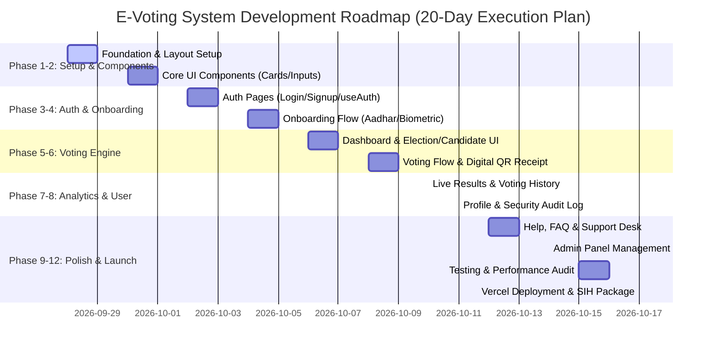

# 🗺️ Project Roadmap — Smart Secure E-Voting System Frontend

> **Project Name:** Smart Secure E-Voting System Frontend  
> **Author / Target:** Harsh Yadav (B.Tech ECE IV, LNCT Bhopal)  
> **Purpose:** SIH 2026 (Smart India Hackathon) Submission + Professional Portfolio  
> **Tech Stack:** Next.js (App Router), React 19, TypeScript, Tailwind CSS (Dark Glassmorphism), Recharts, Zustand / Context API, localStorage  
> **Status:** Phase 1 Foundation & Architecture Initialization  

---

## 🎯 Executive Summary

**Smart Secure E-Voting System Frontend** is a complete, 18-page modern web platform designed for secure, transparent, and accessible digital voting. Built for SIH 2026 and portfolio presentation, it features multi-step voter onboarding (Aadhar verification, biometric registration simulation), election browsing, candidate profiles, vote confirmation, digital QR receipt generation with SHA-256 tamper verification, real-time analytics with interactive charts, user profile & security audit logs, and an admin management dashboard.

---

## 🎨 Design & Architectural Specifications

- **Theme:** Exclusive Dark Glassmorphism (`#0a0e27` background, `#141829` card background, backdrop blur)
- **Palette:** Primary Teal (`#4ec9b0`), Secondary Blue (`#7f8cff`), Accent Cyan (`#00d9ff`), Purple (`#d946ef`), Success (`#10b981`), Warning (`#f59e0b`), Error (`#ef4444`)
- **State & Storage:** `localStorage` persistence with custom hooks (`useAuth`, `useVoting`, `useBiometric`)

---

## 📌 Implementation Timeline & Gantt Chart

---

## 📅 Phase-by-Phase Detailed Plan

### 🚀 Phase 1: Foundation & Global Layout (Days 1–2)
- [ ] Configure global glassmorphic design system tokens in Tailwind CSS (`globals.css`, colors `#0a0e27`, `#141829`, `#4ec9b0`)
- [ ] Build sticky Header component with brand logo, notifications bell, user avatar, and status badge (`src/components/Header.tsx`)
- [ ] Build collapsible Sidebar component with 18 route navigation links (`src/components/Sidebar.tsx`)
- [ ] Implement Root Layout wrapper dynamically rendering Header & Sidebar for app pages (`src/app/layout.tsx`)

### 🧩 Phase 2: Core UI Components (Days 3–4)
- [ ] Build `StatCard.tsx` with trend metrics and custom glassmorphism styling
- [ ] Build `ProgressBar.tsx` for tracking multi-step onboarding completion (40%, 60%, 80%, 100%)
- [ ] Build reusable `Button.tsx` (Primary, Secondary, Ghost, Danger, Loading states)
- [ ] Build `FormInput.tsx` with floating label, validation error feedback, and icon prefix
- [ ] Build `Modal.tsx` popup dialog and `Alert.tsx` notification banners

### 🔐 Phase 3: Authentication System (Days 5–6)
- [ ] Build Login Page (`/login`) with email/password validation & OAuth provider buttons (Google, Microsoft, Apple)
- [ ] Build Signup Page (`/signup`) with full registration form (Name, Email, Phone, DOB, City)
- [ ] Develop `useAuth.ts` hook for authentication state management & `localStorage` session handling

### 🆔 Phase 4: Voter Onboarding Flow (Days 7–8)
- [ ] Build Aadhar Verification Page (`/aadhar-verify`) with 12-digit Aadhar format validator and simulated 6-digit OTP verification (Step 2/5 - 40%)
- [ ] Build Biometric Registration Page (`/biometric`) with 4 interactive scan modes (Face scan, Fingerprint, QR Code, Iris scan) (Step 3/5 - 60%)
- [ ] Build Notifications & Settings Page (`/notifications`) with preferences checkboxes, language dropdown, and 2FA trigger (Step 4/5 - 80%)

### 🗳️ Phase 5: Dashboard & Election Exploration (Days 9–10)
- [ ] Build Dashboard Home (`/`) with voter stats, quick actions, activity charts, and election summary
- [ ] Build Elections Page (`/elections`) displaying National, Municipal, and Student Council elections with status tags
- [ ] Build Candidates Page (`/candidates`) with party filter, search bar, candidate rating badges, and modal detail views
- [ ] Create `CandidateCard.tsx` displaying achievements, promises, and rating stars

### 📝 Phase 6: Voting Engine & Digital Receipt (Days 11–12)
- [ ] Build Voting Confirmation Page (`/voting`) with candidate preview box, finality warning, and mandatory confirmation checkbox
- [ ] Build Digital Vote Receipt Page (`/receipt`) generating QR code, unique voter SHA-256 vote hash, timestamp, and print/download/share actions
- [ ] Develop `useVoting.ts` hook for vote immutability enforcement (1 vote per election per user)

### 📊 Phase 7: Live Results & Analytics (Day 13)
- [ ] Build Live Results Page (`/results`) with vote distribution pie charts, time trend line graphs, candidate rankings, and standings table
- [ ] Build Voting History Page (`/voting-history`) listing past votes with receipt lookup links

### 👤 Phase 8: Profile & Security Audit (Day 14)
- [ ] Build Profile Page (`/profile`) showing user bio, verified biometric status badges, and account details
- [ ] Build Security Page (`/security`) featuring password updates, active sessions table, and security audit log

### ❓ Phase 9: Help Center & Support Desk (Days 15–16)
- [ ] Build FAQ Page (`/faq`) with 6 interactive Q&A accordion cards
- [ ] Build Voter Guide Page (`/guide`) detailing step-by-step voting instructions
- [ ] Build Support Page (`/support`) with 4 support channels (Email, Live Chat, Phone, AI Chatbot) and ticket submission form

### ⚙️ Phase 10: Admin Control Panel (Day 17)
- [ ] Build Admin Panel Page (`/admin`) featuring system metrics (Total Users, Turnout %, System Health 99.99%), user role management table, and growth charts

### 🧪 Phase 11: Testing, Responsiveness & Polish (Days 18–19)
- [ ] Mobile responsiveness audit across iOS & Android screen widths (sidebar drawer, card grids)
- [ ] Accessibility review (ARIA tags, high contrast text `#e0e0ff`, keyboard nav)
- [ ] Data state verification (`localStorage` initial seed and reset testing)

### 🚀 Phase 12: Deployment & SIH Submission Package (Day 20)
- [ ] Configure Vercel deployment pipeline
- [ ] Prepare comprehensive `README.md` with demo screenshots and user credentials
- [ ] Package final SIH 2026 presentation artifact

---

## 📊 Complete 18-Page Navigation Map

| # | Route | Page Title | Primary Function |
|---|---|---|---|
| 1 | `/login` | Login | Authentication & OAuth |
| 2 | `/signup` | Signup | Account Registration |
| 3 | `/aadhar-verify` | Aadhar Verification | Identity Verification (40%) |
| 4 | `/biometric` | Biometric Registration | Face/Fingerprint Setup (60%) |
| 5 | `/notifications` | Notification Preferences | Settings Setup (80%) |
| 6 | `/` | Dashboard Home | Overview, Quick Links & Analytics |
| 7 | `/elections` | Active Elections | Browse Elections |
| 8 | `/candidates` | Candidates List | Filter & View Candidate Details |
| 9 | `/voting` | Voting Confirmation | Cast & Confirm Vote |
| 10 | `/receipt` | Vote Receipt | Digital Receipt & QR Verification |
| 11 | `/results` | Live Results | Analytics & Standings |
| 12 | `/voting-history` | Voting History | Personal Voting Timeline |
| 13 | `/profile` | User Profile | Personal & Verification Info |
| 14 | `/security` | Security & Privacy | Password, 2FA, Audit Logs |
| 15 | `/faq` | FAQ | Frequently Asked Questions |
| 16 | `/guide` | Voter Guide | Step-by-Step Instructions |
| 17 | `/support` | Support Desk | Customer Support & Tickets |
| 18 | `/admin` | Admin Panel | System Management & Stats |

